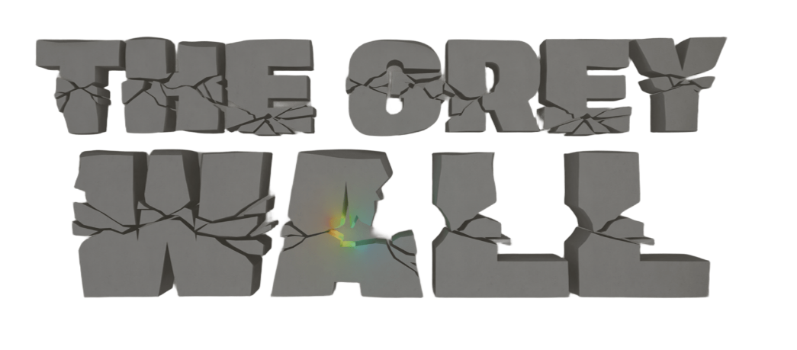

  

  <b>A Unity game demo developed by Politecnico di Torino students.</b>

  
  

---

## 📖 Overview
**The Grey Wall** is a atmospheric video game demo created in **Unity** as part of an academic examination at **Politecnico di Torino**. 

This repository serves as the official project showcase, featuring game documentation, media assets, and direct access to the playable build.

### ✨ Key Highlights
* 🎮 **Playable Demo:** Available for download on Itch.io.
* 📄 **Pitch Document:** Comprehensive breakdown of mechanics, target audience, and scope.
* 🎬 **Teaser Trailer:** Full video preview showcasing environment and mood.

---

## 👥 Development Team

| Name | Role & Responsibilities | Links |
| :--- | :--- | :--- |
| **Lorenzo Bosso** | Level Design & Programmer |  |
| **Matteo Cucchiara** | 3D Artist & World Building |  |
| **Luca Biga** | Producer & Sound Design |  |
| **Mattia Riccardi** | UI Design & Programmer |  |
| **Federico Francioso** | Producer & Programmer |  |

---

  <i>Developed for Politecnico di Torino</i>

